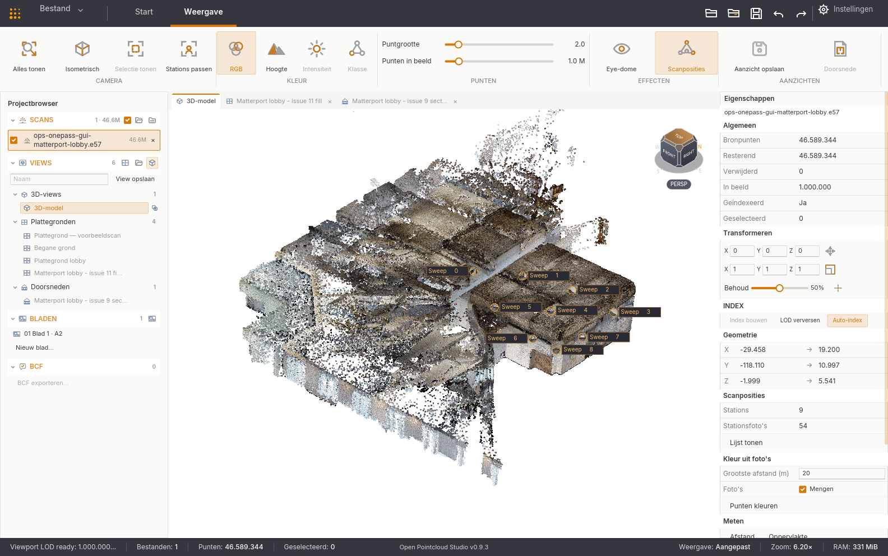

# Weergave-ribbon — definitief ontwerp

Referentiecanvas: 1584 × 992 px. De donkere tabbalk blijft 48 px hoog; de witte ribbon loopt van y=48 tot y=164. Alleen **Start** en **Weergave** zijn tabs; extensies blijven bereikbaar via **Bestand → Extensies**. Weergave is actief met een dunne oranje onderstreping.

| Groep | Breedte bij 1584 px | Bediening |
| --- | ---: | --- |
| Camera | 382 px | Alles tonen, Isometrisch, Selectie tonen, Stations passen |
| Kleur | 288 px | RGB, Hoogte, Intensiteit, Klasse; actieve modus in zacht oranje vlak |
| Punten | 378 px | Puntgrootte en Punten in beeld als twee leesbare schuifregelaars met waarde rechts |
| Effecten | 230 px | Eye-dome en Scanposities als herkenbare schakelaars |
| Aanzichten | 290 px | Aanzicht opslaan en Doorsnede |

De pictogrammen hebben dezelfde lijndikte en basishoogte als de goedgekeurde Start-ribbon. Korte labels staan direct onder ieder pictogram; schuifregelaars hebben expliciete tekst en een getal. Een fijne verticale lijn scheidt groepen, en een kleine groepsnaam staat onderaan. Bij minder breedte klappen groepen als geheel in tot een knop met vervolgmenu, te beginnen rechts. Export, meten en indexering horen niet in deze Weergave-indeling.

De indeling is nu in de native Rust-UI verwerkt. [Screenshot van v0.9.3](../screenshots/weergave-ribbon-v093.png).
