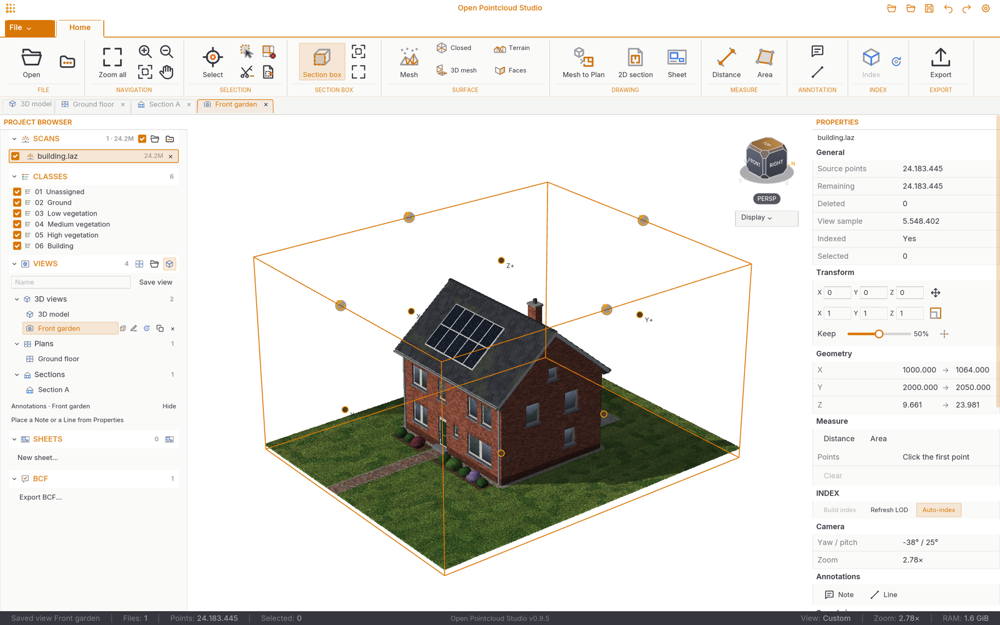

# Open Pointcloud Studio — handleiding

Deze handleiding beschrijft de native Rust-applicatie vanaf **v0.9.5**. De ribbon heeft één tabblad **Start**; weergaveopties staan onder de kijkkubus. **Bestand** opent een backstage met directe acties.

## Snel beginnen

1. Open **Bestand → Puntenwolk importeren…** of klik op **Openen** in de ribbon. Kies een E57-, LAS-, LAZ-, PLY-, PCD-, PTX-, PTS- of tekstbestand. Je kunt ook bestanden, een scanmap of een `.rcp`-scanproject op het venster slepen.
2. Wacht totdat de scan verschijnt. Bij grote bestanden komt eerst een voorbeeld in beeld; het indexeren op de achtergrond levert later meer detail. De voortgang staat boven de 3D-weergave.
3. Gebruik het muiswiel om op de aanwijzer in te zoomen. Sleep met de middelste of rechter muisknop om te pannen. Gebruik **Alt + linkersleep** of **Shift + middelsleep** om te draaien. **F** toont het hele model.
4. Klik links in de projectbrowser op een scan om die actief te maken. De eigenschappen van die scan verschijnen rechts.

## Het venster

De projectbrowser links bevat de scans, klassen, opgeslagen weergaven, bladen en BCF. In het midden staat het 3D-model of een geopende tekening; tabbladen daarboven wisselen ertussen. Het paneel **Eigenschappen** rechts toont gegevens van de actieve scan en instellingen van het actieve gereedschap. De statusbalk onderaan toont onder andere aantallen punten, selectie, zoom en geheugengebruik.

**Start** bevat openen, navigatie, selectie, snedebox, oppervlak, meten, tekenen en export. **Weergave** onder de kijkkubus bevat camerastanden, puntkleuren, puntgrootte, puntbudget, verlichting en scannerposities. Op een smaller venster klappen ribbongroepen in een uitklapmenu. Instellingen staan rechtsboven; extensies onder **Bestand → Extensies**.

## Navigeren en selecteren

- **Linkerklik** selecteert een punt. **Linkersleep** trekt een rechthoek rond punten; met de selectiegereedschappen kun je ook een groter gebied kiezen.
- **Dubbelklik** op een punt zet het draaipunt daar. Dubbelklik op de achtergrond of gebruik **Alles tonen** om weer rond het modelcentrum te draaien.
- **Rechtsklik** in de 3D-weergave opent het contextmenu. **Escape** verlaat eerst het actieve gereedschap en brengt je terug naar selecteren; bij een volgende Escape wordt de selectie opgeheven.
- **Delete** verbergt geselecteerde punten. **Ctrl+Z** maakt de laatste verwijdering of fotokleuring ongedaan; **Ctrl+Y** herhaalt die.
- De **view cube** geeft de oriëntatie aan; klik op een vlak of hoek voor een vaste kijkrichting.

## Grote scans en snelheid

Voor scans met minstens een miljoen punten bouwt de app automatisch een octree-index op schijf. Het 3D-venster leest daaruit alleen de punten die voor de huidige camera nodig zijn, tot het ingestelde puntbudget. De originele scan wordt daarbij niet veranderd. Een ongewijzigd bestand gebruikt bij een volgende opening de bestaande index. Via **Weergave** onder de kijkkubus kun je het puntbudget aanpassen; bij diepe zoom worden punten voor dat deel van het model opnieuw geladen. Bij een groot E57-bestand verschijnt eerst een verspreid voorbeeld, terwijl de volledige scan op de achtergrond wordt gelezen.

## Meten

Kies **Afstand** op Start en klik de meetpunten in de 3D-weergave. **Enter** voltooit de meting; **Backspace** verwijdert het laatst geplaatste punt. Voor een vlakmeting kies je **Oppervlakte**, klik je de hoekpunten en rond je af met Enter. Het resultaat en de actieve meetinstellingen verschijnen in **Eigenschappen**. Met **Escape** verlaat je het meetgereedschap.

## Snedebox en 2D-tekeningen

Zet **Snedebox** aan om een deel van het model zichtbaar te houden. Versleep de vlakken of vul onder **Eigenschappen → Snedebox** de XYZ-grenzen in. De box kan ook worden gedraaid. Voor een plattegrond leg je het bovenvlak op de gewenste snijhoogte; voor een verticale doorsnede kies je het betreffende zijvlak.

Maak vervolgens via **Doorsnedetekening** een **plattegrond**, **aanzicht** of **doorsnede**. Stel de dikte van de snijlaag in en gebruik **Voorbeeld** om punten en eventuele gevulde doorsneden te controleren. **Rechte CAD-lijnen** maakt bovendien bewerkbare lijnen bovenop de gemeten contour en vulling, met instelbare afwijking. Exporteer daarna naar DXF of DWG. Een voorbeeld van een plattegrond: bovenvlak op 1,10 m, snijlaagdikte 0,10 m; de tekening gebruikt dan de punten tussen 1,00 en 1,10 m.

## Oppervlakken, meshes en export

**Mesh Pointcloud** biedt verschillende methoden voor reconstructie; je kunt het gebied met de snedebox beperken en de gewenste resolutie instellen. Controleer het resultaat in de 3D-weergave voor export. De methode **Vlakke vlakken** zoekt onder andere wanden, vloeren en cilindrische elementen; dit levert semantische vlakken op en is iets anders dan een doorlopend driehoeksmesh. De nauwkeurigheid hangt af van puntdichtheid, ruis en gekozen resolutie. De volledige technische uitleg en de grenzen per methode staan in de [uitgebreide gebruikershandleiding](https://github.com/OpenAEC-Foundation/open-pointcloud-studio/blob/main/docs/guide.md#mesh-pointcloud).

Via **Bestand → Alle exportopties…** vind je de beschikbare puntcloud-, mesh- en tekeningformaten; de meestgebruikte exports staan ook direct in het menu van **Bestand**. Kies bij puntcloudexport desgewenst een stapgrootte om bijvoorbeeld ieder tiende punt te schrijven. Bekijk vóór export welke scan actief is en welke punten zijn geselecteerd of verborgen.

## Scannerposities en foto's

E57-scans kunnen stations en foto's bevatten. Zet scannerposities zichtbaar, klik op een stationbol om vanuit dat station rond te kijken en klik op een ander station om erheen te gaan. Een losse E57-foto opent in een eigen tabblad; de modelcamera blijft bewaard. Met **Naast 3D tonen** zie je het model en de foto tegelijk. Versleep de scheidingslijn of kies **Onder elkaar** om ze boven elkaar te tonen. De modelhelft heeft een eigen draaibeweging, pan, zoom en kijkkubus. De indeling blijft na een herstart bewaard. Tijdens het lopen gebruik je **W/A/S/D** en **Q/E** voor omlaag/omhoog. Met **Escape** keer je terug naar de gewone 3D-weergave. Onder **Kleur uit foto's** kun je scanpunten kleuren met de bijbehorende foto's; controleer de maximale afstand tussen foto en punt voordat je dit uitvoert.

## Opgeslagen weergaven en bladen

Geef in de projectbrowser een naam op en kies **Weergave opslaan** om camera, zichtbaarheid en relevante weergave-instellingen vast te leggen. Open een weergave door op de rij te klikken; hij krijgt een eigen tabblad. Onder **BLADEN** kun je tekeningen en weergaven op een blad samenstellen voor presentatie of export.

## Toetsen in één oogopslag

| Invoer | Actie |
| --- | --- |
| Muiswiel | Zoom bij de aanwijzer |
| Middel- of rechtersleep | Pan |
| Alt + linkersleep / Shift + middelsleep | Draai de camera |
| F | Toon het hele model |
| Linkerklik / linkersleep | Selecteer punt / rechthoek |
| Delete | Verberg geselecteerde punten |
| Ctrl+Z / Ctrl+Y | Ongedaan maken / opnieuw |
| Enter / Backspace | Meting afronden / laatste meetpunt verwijderen |
| Escape | Gereedschap verlaten of selectie opheffen |
| Ctrl+Tab | Volgend geopend tabblad |

Op macOS gebruik je doorgaans **Command** in plaats van **Ctrl**, behalve voor het wisselen van tabbladen.

## Meer informatie

- [Uitgebreide gebruikershandleiding](https://github.com/OpenAEC-Foundation/open-pointcloud-studio/blob/main/docs/guide.md)
- [Ondersteunde formaten en mogelijkheden](https://github.com/OpenAEC-Foundation/open-pointcloud-studio#readme)
- [API-documentatie](https://github.com/OpenAEC-Foundation/open-pointcloud-studio/blob/main/native/API.md)
- [Releases en downloads](https://github.com/OpenAEC-Foundation/open-pointcloud-studio/releases)
