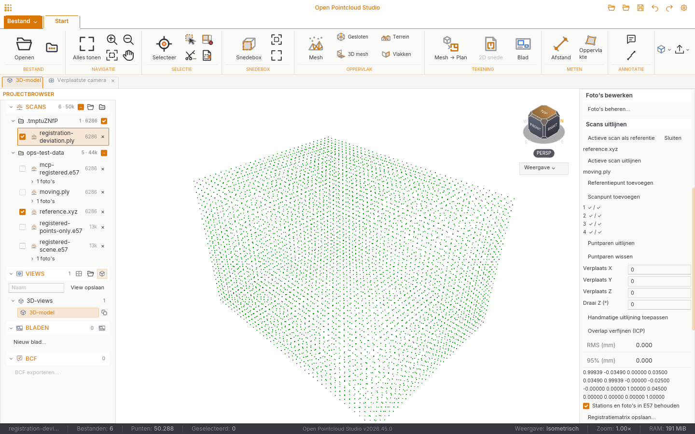
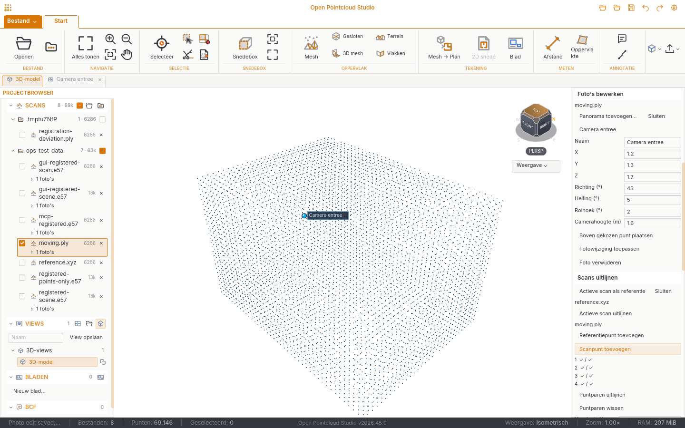
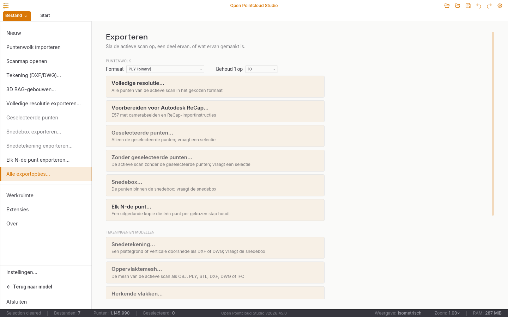

# Validation of 2026.45.0

Development validation on Linux, 3 November 2026. This record distinguishes
local development checks from the installer/signing verification that the
release workflow attaches to the published release.

## Automated checks

- Locked Rust workspace: **1,375 passed, 12 intentionally ignored, 0 failed**.
  This includes 727 desktop, 561 core, 42 server and 21 shared UI tests,
  plus SDK, integration and example tests.
- Workspace Clippy, all targets, warnings denied: passed. The core also
  passes Clippy without default features.
- The complete desktop suite was repeated after the narrow-panel layout
  correction, registration job fix and closed-photo-editor correction:
  730 passed, 9 intentionally ignored, 0 failed.
- The closed-editor regression was reproduced before the fix. Closing its
  source now clears the editor, including when a provisional import is
  removed; closing an unrelated scan retains the camera draft.
- The cancellation regression verifies that cancelling retains the original
  job ID and reports `cancelled`, and that a running registration refuses
  input/matrix changes.
- Rust formatting and whitespace checks: passed.
- Release package-script checks: 90 passed. Actionlint 1.7.12 validates all
  workflows. Offline OpenPGP verification rejects a wrong fingerprint and
  a modified AppImage, including the secret-subkey-only signing case.

## Running native application, API and MCP

The native development build reports `open-pointcloud-studio 2026.45.0`.
Tests used an isolated configuration and command API on loopback, separate
from the user's settings. Application code and UI remain Rust; independent
Python readers were validation tools only and are not runtime dependencies.

A generated 4 × 3 × 2.5 m room contains 6,286 points per input, in XYZ and
PLY. The moving scan has a known 2° Z rotation and translation of
[0.035, -0.025, 0.045] m. Noisy correspondence targets produced a coarse
RMS of 1.405 mm. Point-to-plane ICP converged in three iterations with
5,975 matched samples; independent full-resolution world-coordinate p95
error was below 1e-8 m against the known transform. These are exact synthetic
surfaces, not a claim of achievable accuracy on measured scanner data.

The running API exercised panorama add/edit/delete, Undo/Redo, decoding and
photo/3D comparison; coarse registration, ICP, matrix reuse, registered scan
and scene exports, points-only E57, mixed-format merge, LAZ and ReCap
preparation. The independent reader found 12,572 points and the embedded
panorama in the registered two-scan E57. CLI `--register-points` output was
reapplied with `--apply-registration` to the full moving source.

A real stdio MCP client negotiated protocol 2025-11-25 and listed all 164
tools. It selected the running test window, edited photos, fitted point
pairs, refined with ICP, set/read a matrix, exported a registered scan,
prepared a ReCap transfer, and requested a full-window screenshot. An
additional 50,000-point-per-scan fixture exercised MCP cancellation: the
original job wait returned `cancelled` without a replacement job. The live
HTTP API cancellation passed the same original-job check.

Physical GUI interaction exercised the picked-reference/picked-moving
buttons, coarse fit, clearing pairs, manual alignment, the native panorama
file chooser, camera height above a selected point, editing/applying/deleting
photos, and the title-strip Undo/Redo buttons. The GUI also saved a matrix
and exported both a full-resolution registered scan and a registered scene,
which the independent E57 reader counted and checked for images. The File export tile and
native Save dialog produced a ReCap E57 containing both GUI-added images and
a companion import-instructions file. Visual review at the default 240 px
Properties width found wrapped button labels; the registration and photo
edit controls now use separate rows, and the photo editor identifies its
source scan. Photo edits also survived restarting the application.

## Real scanner data and independent readers

Source: the E57 committee's [public sample data](https://e57-3d-imgfmt.sourceforge.net/data.html),
Calabi Yau Systems Manitou, captured with a Riegl Z420I and LD3 Texel Camera.
© 2012 Calabi Yau Systems LLC. Test files are not committed to this repository.

| Source | SHA-256 |
| --- | --- |
| `manitouNoInvalidPoints.e57` | `d4f06e2a80e3e54be7391130b911c82af0c6a7857cec133177431f5f578f23cf` |
| `manitou.e57` | `0f79cddf8b98bcf6e0a9013bc911ac67975e697522ed0bb948da662ed424da50` |

Both sources have five scans, five spherical JPEG images and 1,095,702 valid
points. The second also carries invalid returns. Exported files were read
by **C++ libE57 through pye57 0.4.19**, independently of the Rust reader.

- A registered E57 retained all five image blobs byte for byte (SHA-256),
  image/scan GUID associations, scan names, and the raw intensity, row,
  column and validity values for retained points. Maximum independent
  world-coordinate error against the applied matrix was 2.25e-14 m.
- Section exports from both sources contained the independently calculated
  **345,057** valid points and all five original images/associations.
- Colour from photos in the running application coloured **894,556** points;
  the exported E57 kept all 1,095,702 valid points and five original images.
- CLI merge of the real E57 and a LAZ input produced **1,108,274** points.
  The E57 output had six scans and five images; the normalised LAZ was fully
  decoded and counted by **laspy 2.7.0 / lazrs 0.8.2**.

On this machine the real E57-plus-LAZ merge took about 11.1 s for E57 and
4.5 s for LAZ, including independent validation. These are development-run
measurements, not a cross-platform benchmark.

## Measured static/SLAM overlap

After the initial checks, the public [Oxford Spires dataset](https://huggingface.co/datasets/ori-drs/oxford_spires_dataset)
provided a measured pair from the Bodleian Library site: the Leica RTC360
`ground_truth_map/bodleian-library/merged-cloud-1cm.e57` and VILENS SLAM
clouds from `2024-05-20-bodleian-library-02`. This overlap is a courtyard,
not an indoor room. The dataset is CC BY-NC-SA 4.0; raw data and derived
point clouds are not included in this repository or the installers.

The running native development build opened the **3,640,843,264-byte E57**,
decoded all **190,797,374 points** in approximately **78.5 seconds**, and
retained a bounded 2,000,000-point viewport sample. Automatic indexing was
disabled for this import measurement.

The GitHub Linux AppImage also passed the running API/CLI and MCP feature
checks, including original-job cancellation. With a fresh application-cache
key and warm filesystem cache, the release build showed its first preview
in 0.27 s and completed the full import in 22.83 s, with peak RSS 924 MiB.
An exact source selection, using the same box as the independently read
static region below, found all 2,722,685 expected points in 16.31 s.

An independent preparation script assembled 30 consecutive-route PCD
frames using their published SLAM VIEWPOINT poses, without replacing them
with ground-truth poses. It used the published trajectories only for an
approximate rigid starting alignment. A common region contained 2,722,685
static points and 146,276 moving points. OPS refined this pair in about
1.4 seconds, using 31 iterations and 46,495 matched preview samples.

Independent SciPy nearest-neighbour distances against the complete static
region improved as follows. These include unmatched objects and occlusions;
they are not the trimmed sampled residuals shown in the application.

| Full moving region metric | Before ICP | After ICP |
| --- | ---: | ---: |
| Median nearest-static-point distance | 22.49 mm | 17.32 mm |
| Mean distance | 89.31 mm | 85.64 mm |
| 95th percentile | 548.11 mm | 542.92 mm |
| Points within 50 mm | 80.57% | 81.63% |

The application's sampled RMS/p95 were 59.95/91.42 mm. The merged E57 was
independently read by libE57: both scans retained all **2,868,961 points**,
and the maximum coordinate difference from applying the saved matrix was
6.37e-14 m. A rigid registration does not remove accumulated SLAM drift.
The downloaded E57 contains zero Images2D entries, so this test does not
validate a vendor SLAM panorama export.

| Download | SHA-256 |
| --- | --- |
| Bodleian merged TLS E57 | `aa49a92aee68a07be8d4cf7f9f412ed98ad70423fd8fd8e7f8ed1b110d1bfb01` |
| Bodleian sequence-02 VILENS SLAM `undist-clouds.zip` | `be0d787b15c09e493025a97b630da8c7363548e91d8df1f1f5ffd88a43796bf2` |

## Coverage limits

A vendor SLAM E57 with panoramas and a static/SLAM pair of the same physical
room were not available. The measured courtyard pair above, synthetic
route-photo/projection tests and a room with known geometry cover the
algorithms; #42 and #44 retain the remaining vendor/indoor field checks.
No scanner-vendor certification is claimed.

ReCap Pro was not run on this Linux machine. The implemented E57 transfer
and image associations were validated independently against Autodesk's
[documented import schema](https://help.autodesk.com/cloudhelp/ENU/Reality-Capture/files/Creating_Scan_Projects/Importing_Scans/E57_Panorama_Images/import_e57_support.html).
Direct RCP/RCS writing requires Autodesk SDK access and licensing;
[ReCap interoperability](../recap-interoperability.md) records the decision
and working interchange route.
